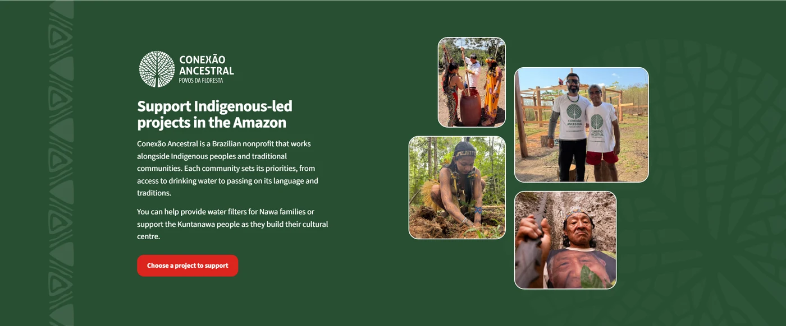

# Conexão Ancestral na home

**CONFIRMADO por Danilo em 23/11/2026.** A home da Katukina apresenta a ONG, convida o visitante a contribuir e usa a cartela de cinco cores fornecida pelo responsável. O mosaico da seção de valores do site oficial serve de referência para as fotos. [Abrir a seção local](http://localhost:3001/#conexao-ancestral) · [Site da ONG](https://www.conexaoancestral.org/)

## Paleta

HEX e RGB são as referências para a tela. A coluna CMYK reproduz as porcentagens da cartela. A coluna HSB foi calculada a partir do RGB, com valores arredondados.

| Cor | HEX | RGB | HSB | CMYK (%) | Aplicação nesta seção |
| --- | --- | --- | --- | --- | --- |
| Vermelho | `#DC251E` | 220, 37, 30 | 2°, 86%, 86% | 8, 98, 100, 1 | Fundo do botão em repouso, hover, foco e acionamento |
| Verde | `#284E32` | 40, 78, 50 | 136°, 49%, 31% | 80, 44, 84, 44 | Fundo de toda a seção |
| Carvão | `#191A1F` | 25, 26, 31 | 230°, 19%, 12% | 76, 69, 61, 76 | Texto selecionado |
| Branco | `#FFFFFF` | 255, 255, 255 | 0°, 0%, 100% | 0, 0, 0, 0 | Título, parágrafos, logotipo de prévia, texto do botão e contorno de 2 px das quatro fotos |
| Amarelo | `#D5B314` | 213, 179, 20 | 49°, 91%, 84% | 18, 24, 96, 4 | Contorno de foco do botão e fundo da seleção de texto |

O HSB impresso sob o amarelo repete o do vermelho. O HEX e o RGB fornecidos para o amarelo correspondem a 49°, 91%, 84%. Em superfícies sólidas, o contraste calculado é de 9,43:1 para branco sobre verde, 4,85:1 para branco sobre vermelho e 4,62:1 para o foco amarelo sobre verde.

## Composição e conteúdo

No hover com mouse, um contorno branco de 2 px aparece da esquerda para a direita em 220 ms, acompanhado de uma sombra suave. O foco pelo teclado exibe o contorno branco e o anel amarelo. Com a preferência por movimento reduzido, a mudança é imediata.

- **Escala do logotipo.** A largura acompanha 43% da coluna de texto, entre 172 e 240 px no tamanho de fonte padrão. A marca conserva sua proporção horizontal.
- **Desktop.** O logotipo abre a coluna esquerda, seguido do título, da apresentação da ONG e do botão. O mosaico ocupa a direita.
- **Até 880 px.** O texto e a chamada vêm primeiro. As quatro fotos seguem abaixo, em duas colunas.
- **Conteúdo.** O texto em inglês explica que a ONG brasileira trabalha com povos indígenas e comunidades tradicionais. O convite cita os filtros de água para famílias Nawa e o centro cultural Kuntanawa. O botão “Choose a project to support” abre a lista oficial de projetos, onde o visitante pode escolher uma iniciativa para apoiar. [Apresentação institucional](https://www.conexaoancestral.org/about-us) · [Projetos e formas de contribuir](https://www.conexaoancestral.org/projects)

## Imagem de fundo

Salve **`fundo-conexao-ancestral.webp`** na [pasta de fundo](../../public/images/home/conexao-ancestral/fundo/). O tamanho recomendado é **1920 × 800 px**, em WebP horizontal. A imagem cobre toda a faixa, com recorte central. No celular, apenas parte da largura da arte fica visível. Componha o fundo com pouco detalhe na metade esquerda, onde fica o texto no desktop. O site aplica uma camada verde sobre a imagem e usa o fundo sólido `#284E32` enquanto o arquivo estiver ausente.

## Como trocar as imagens

Coloque os arquivos em [public/images/home/conexao-ancestral](../../public/images/home/conexao-ancestral/) e atualize a home local. Cada posição aceita uma substituição independente.

| Pasta | Posição | Enquadramento |
| --- | --- | --- |
| `logo/` | Em destaque acima do título | Horizontal, preservado por inteiro. SVG mantém a nitidez da marca ampliada |
| `foto-principal/` | Superior direita, maior | Horizontal, aproximadamente 1,16:1 |
| `foto-secundaria/` | Inferior esquerda | Quase quadrado, aproximadamente 0,94:1 |
| `foto-03/` | Superior esquerda, menor | Retrato 3:4 |
| `foto-04/` | Inferior direita | Quase quadrado, aproximadamente 1,04:1 |

As fotos aceitam JPG, JPEG, PNG, WebP e AVIF. O logotipo também aceita SVG. Logos personalizados aparecem com as cores originais sobre uma base branca. Para um logo branco com transparência, use o final `-branco` antes da extensão, por exemplo `marca-branco.svg`, para exibi-lo diretamente sobre o verde.

Se houver várias imagens na mesma pasta, vale a data de modificação mais recente. Em caso de empate, vale a ordem alfabética do nome. O arquivo opcional `descricao.txt` de cada pasta de foto recebe o texto alternativo em inglês. Enquanto a pasta estiver sem imagem, a prévia usa sua própria descrição.

## Materiais e manutenção

As prévias locais correspondem às fotos `values-01.webp` a `values-04.webp` da seção de valores da ONG. [Fonte dos materiais](https://www.conexaoancestral.org/)

O conteúdo está no [componente da home](../../components/home/conexao-ancestral.tsx), a grade e a paleta no [CSS da seção](../../components/home/conexao-ancestral.module.css) e a escolha dos arquivos no [leitor de mídia](../../lib/conexao-ancestral-media.ts). A aprovação dos recortes das imagens definitivas cabe ao responsável após a substituição das prévias.

## Validação local em 23/11/2026

Typecheck, build e teste Playwright da home aprovados. A verificação da seção cobriu oito larguras entre 320 e 1880 px, incluindo os dois lados do ponto de mudança em 880 px. O conteúdo ficou à esquerda do mosaico no desktop e acima dele no celular. O botão recebeu foco por teclado e apontou para os projetos. O fundo sólido e o carregamento de um WebP temporário de 1920 × 800 px foram testados na home local.
